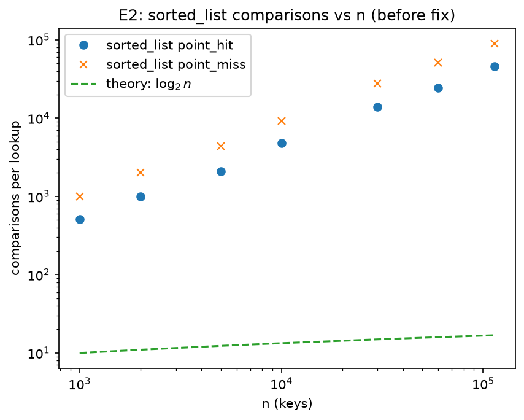
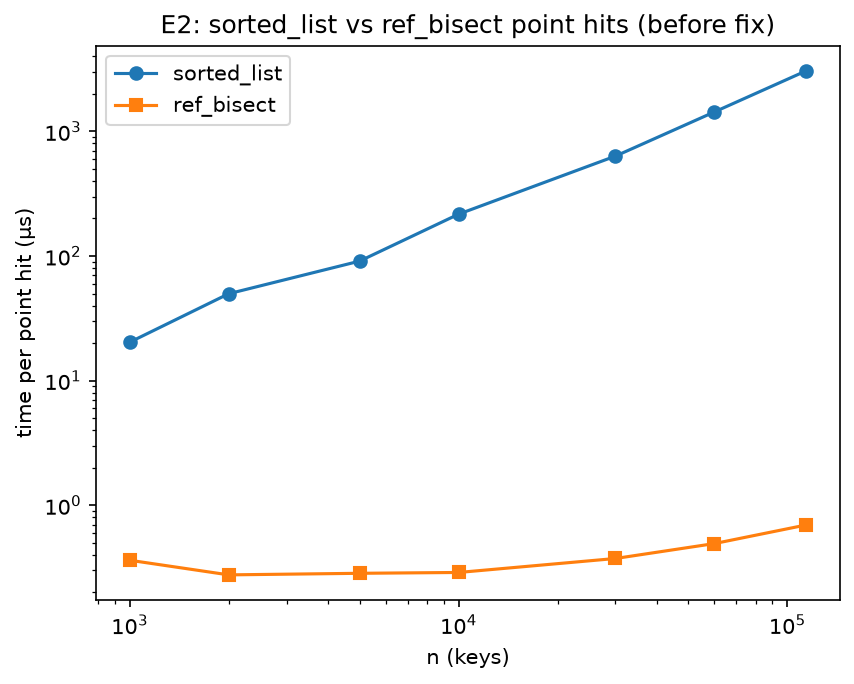
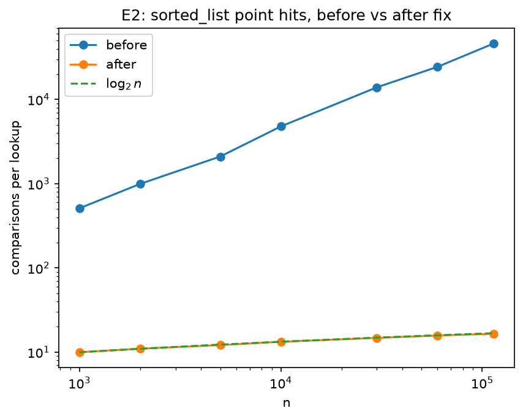

# INC-01: Sorted list point lookups grow with n instead of log(n)


## Summary

Point lookups on `sorted_list` scanned the key list linearly instead of using
binary search, so cost grew with n: at n = 114,000 a hit took about 3,058 µs
and 46,119 comparisons, versus ~17 comparisons expected. Replacing the scan in
`search` with the existing `_bisect_left` helper cut this to 16.5 comparisons
and 1.94 µs per hit, about 1,600× faster.

## Detection

E2 (`code_version f6f773e`) showed the problem: comparisons per lookup grew
linearly with n (log-log slope k = 0.96 for hits and misses) instead of
following log2(n). At n = 114,000, lookups took about 3 ms each, versus under
1 µs for `ref_bisect`, which uses the same sorted layout.

## Expected vs. observed

**Expected:** a sorted list supports binary search, so a point lookup should
cost $O(\log n)$: about $\log_2 n$ comparisons, which is ~10 at n = 1,000 and
~17 at n = 114,000. Hits and misses should cost about the same.

**Observed** (E2, `code_version f6f773e`, medians across 5 reps): comparisons
per hit grew from 510 at n = 1,000 to 46,119 at n = 114,000, about 2,700× the
theoretical ~17. Misses grew from 1,000 to 89,741. The fitted log-log slope
was k = 0.96 for both hits and misses, indicating $O(n)$ growth rather than
$O(\log n)$. Misses examined every distinct key and hits about half as many,
the pattern of a linear scan from the start of the list. At full size, a hit
took about 3,058 µs, versus 0.70 µs for `ref_bisect`.

## Evidence

All rows below are from E2 (`E2_point_track_id`, session `a2ac476ea8ec`,
`code_version f6f773e`).



*Figure 1: comparisons per lookup for `sorted_list` hits and misses on log-log
axes, against the $\log_2 n$ theory line. Both series are parallel lines with
slope k = 0.96, far above the theory line, confirming linear growth.*



*Figure 2: time per point hit for `sorted_list` and `ref_bisect`. Both store keys
in sorted order, but `sorted_list` grows with n while `ref_bisect` stays nearly
flat, reaching a ~4,400× gap at n = 114,000.*

The comparison counters are deterministic, so they rule out noise or hardware as
the cause. The CORE runs on the original code (`code_version`s `2c52c55`, `e9c1863`,
`e9db2d1`) showed identical `sorted_list` counts on all four team machines
(45,613,624 comparisons per 1,000 hits at n = 114,000; CORE uses a different
query set than E2, so the count differs slightly). Other
`sorted_list` operations behaved as expected: build averaged about 15
comparisons per insert, consistent with binary search, which isolates the bug to
`search`.

## Root cause

**File:** `indexes/sorted_list.py`, **function:** `search`, **lines 57–63.**

`search` walks the key list from the start (line 57), comparing each key to the
target until it finds a match (line 59) or passes where the key would be
(line 62). That is a linear scan, costing O(n) comparisons per lookup.

The list is kept sorted precisely so lookups can use binary search, and the
class already has a binary search helper, `_bisect_left` (lines 27–42), which
`insert` and `range_search` both use. `search` should call it as well,
narrowing to the key's position in about log2(n) comparisons.

Both approaches return the same values, since each finds the same key in the
same sorted list, so every correctness test passes. The scan just examines
many more keys: about half the list on a hit, and up to all of it on a miss.
The early `break` on line 63 doesn't change the big-O. This matches the
counters: hits examined about half of the distinct keys, and misses examined
all of them.

## Fix

Replaced the linear scan in `search` with the existing binary search helper
`_bisect_left`, matching how `insert` and `range_search` already locate keys.

```diff
     def search(self, key: Any) -> list[Any]:
-        # The keys are sorted, so we can stop as soon as we have passed the
-        # place where ``key`` would be.
-        comparisons = 0
-        for i, k in enumerate(self._keys):
-            comparisons += 1
-            if k == key:
-                self.stats.comparisons += comparisons
-                return self._values[i]
-            if k > key:
-                break
-        self.stats.comparisons += comparisons
-        return []
+        pos = self._bisect_left(key)    # binary search for where key would be
+        if pos < len(self._keys) and self._keys[pos] == key:    # key is actually there
+            return self._values[pos]
+        return []   # key not found
```

Commit hash: `09fddb5`.

## Verification

E2 was rerun on the fix commit (`09fddb5`) with the same workload and seeds as
the original run (`f6f773e`).



*Figure 3: comparisons per point hit before and after the fix, on log-log axes.
After the fix, the points lie on the $\log_2 n$ theory line.*

Comparisons per hit dropped from 46,119 to 16.5 at n = 114,000, matching the
~17 that binary search predicts. The fitted log-log slope fell from k = 0.96
to k = 0.11. A slope near 0.1 is what $\log_2 n$ itself produces on log-log
axes over this range, so this confirms $O(\log n)$ lookups. Time per hit fell
from 3,058 µs to 1.94 µs, about 1,600× faster. The remaining ~2.7× gap to
`ref_bisect` (0.73 µs in the same after-fix run) is a constant factor: `ref_bisect` runs its binary
search in C, while `sorted_list` runs it in Python.

`make test` passes on `09fddb5` (all tests pass, 3 skipped, the same as before
the fix), so correctness is unchanged.

## Impact on recommendations

The bug affected only point lookups, so it bears directly on **F1 (Track page)**.
Before the fix, `sorted_list` took about 3 ms per lookup at full size, slower even
than the unsorted list and thousands of times slower than the hash table and
trees, which would have ruled it out for F1 entirely. After the fix, at 1.94 µs per lookup, it is in the same range as the
AVL and B+ trees. It still trails the hash table, which remains the natural
choice for F1 since exact-match lookups are its strength.

F2 (prefix search) and F3 (range queries) were unaffected, since
`range_search` already used binary search. Those are the features where a
sorted list is strongest, and before the fix, its poor lookup times could have
unfairly lowered our overall assessment of it. F4 (catalog import) was
unaffected, since `insert` already used binary search.

## Why the tests didn't catch it

The tests only check correctness: does `search` return the right values? A
linear scan and a binary search find the same key in the same sorted list, so
they return identical results, and every test passed. Nothing in the tests
measured how much work a lookup did.

A performance test using the operation counters would catch this. For example:
build a `sorted_list` with n = 10,000 keys, call `reset_stats()`, run one
lookup, and assert that `stats.comparisons` is at most about
$2\log_2 n \approx 27$. Because the counters are deterministic, this test would
fail reliably on the buggy code (thousands of comparisons) and pass on the fix
(~14), with no timing noise or machine dependence.