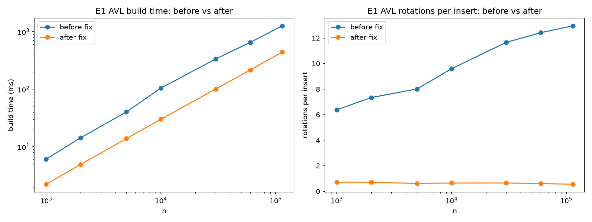
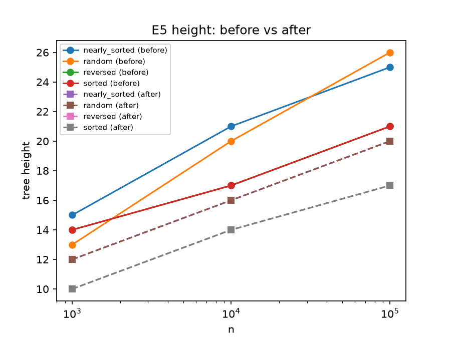
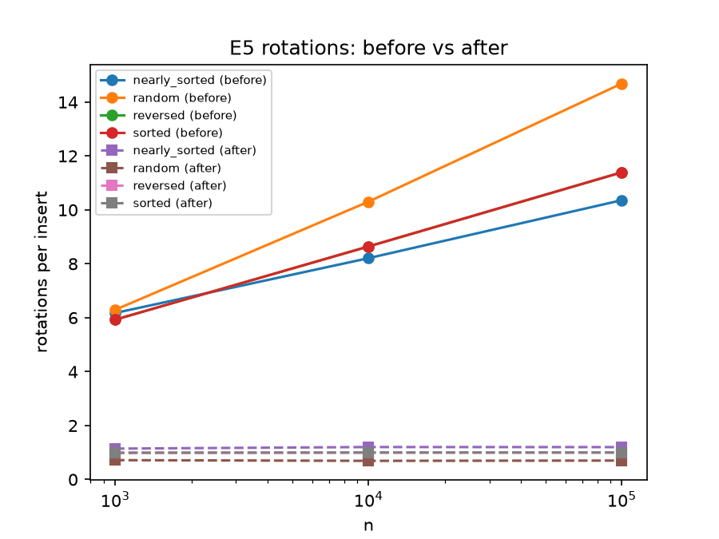

# INC-03: AVL tree does too many rotations due to height update in wrong order


## Summary

The AVL tree did too many rotation - about 13 per inserts instead of at most 1 when building on all track IDs and 
created taller trees than AVL should be. This is because both of the left and right rotations re calculated the parents 
height before calculating the childs height, but parents height is calculated from the child height. Swapping
"_update_height(x)" and "_update_height(y)" fixed it. Build went from around 1,262 ms to 442 ms

## Detection

The insert order at E5 (graph "E5 rotations per insert"), as with every rotation the insert would grow with n, when it 
should stay flat (occured in all 4 insert orders)

## Expected vs. observed

The expected cost is O(n log n). Rotation per insert should be flat as n grows. Height is < than 1.44Xlog2(n). 
So when n is = 100,000 (which is the synthetic data)
it should be at most 23.9.

We observed 
12.95 rotations per insert at n = 114000 (spotify data) - E1
went from 6.3 rotations per insert to 14.7 rotations per insert at n = 100000 - E5
Random height was 26 and nearly sorted height was 25 at 100000 both above 23.9


## Evidence


Made build time slower as you can see the orange line (after) is lower. Rotation orange line(after) is also flat

After lines are lower and are short paths the trees are no longer as tall

in the after rotation doesn't grow even as n grows. tree height in figure comes from "structure_info()"

Because the counters are deterministic, the extra rotations are not caused from noise or issues with laptop.
the code versions were before:f6f773e and after = 549f076

## Root cause

File, function, and line numbers. Explain in plain English what the code does, what it should do,
and why the difference costs time but still gives correct answers.

The file comes from indexes/avl_tree.p and the incorrect functions were the _rotate_right lines 62–63 and _rotate_left 
lines 80–81. A nodes height is supposed to be 1+ the largest height of all its children, then after the rotation the old
parent moves down and becomes a child. In the code it would update the new parent first and therefor using the childs old height
this made the height too large. Because of the wrong height rotations were done that were no needed resulting in incorrect
heights that grew as n grows. The rotations were still correct but were just doing extra work to correct which made the tree
taller.

## Fix

In both rotation functions we swapped the order of the two
update_height(x) & (y) calls so the node that moves down (new child) is updated before
the node that moves up (new parent). Because parent's height is calculated from child heights, 
the child has to be correct first.

 Commits: `27e6aa4` (fixed `_rotate_left`), `549f076` (fixed
`_rotate_right`), and `050f368`. The after-fix
experiments were run on `549f076`.

Diff (`git diff f6f773e..050f368 -- indexes/avl_tree.py`):

```diff
@@ -59,8 +59,8 @@ class AVLTreeIndex(Index):
         y.left = x.right
         x.right = y
         # x and y swapped places; refresh their stored heights.
+        _update_height(y) #y (child) must go first cuz parent h calc from childs height.
         _update_height(x)
-        _update_height(y)
         self.stats.rotations += 1
         return x

@@ -77,8 +77,8 @@ class AVLTreeIndex(Index):
         x.right = y.left
         y.left = x
         # x and y swapped places; refresh their stored heights.
+        _update_height(x) #x (child) must go first cuz parent h calc from childs height.
         _update_height(y)
-        _update_height(x)
         self.stats.rotations += 1
         return y
```

## Verification

Before/after comparison on the same workload and seeds (same experiment, two `code_version`s).
Confirm `make test` still passes.
E1 rotation = 12.95 into 0.55
E5 = random 26 14.7 into 0.7, sorted & reversed 11.4 into 1.00, nearly_sorted 10.4 into 1.20
Height = random 26 into 20, sorted 21 into 17
E1 build = 1262 into 442ms
Make test still passes. 
## Impact on recommendations

F4, the build is still slower than B+ tree so should still use B+ but it is not as poor as it seemed is better but
still not better than B+. The Lookup is a little better went from 16.8 to 15.7

## Why the tests didn't catch it

The test that would catch it is checking rotation per insert is lower or equal to 1 after inserting a key. As well as
making sure the structure_info() height is smaller or equal to 1.44·log2(n)
