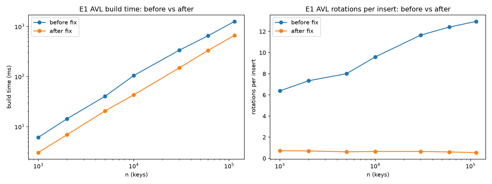
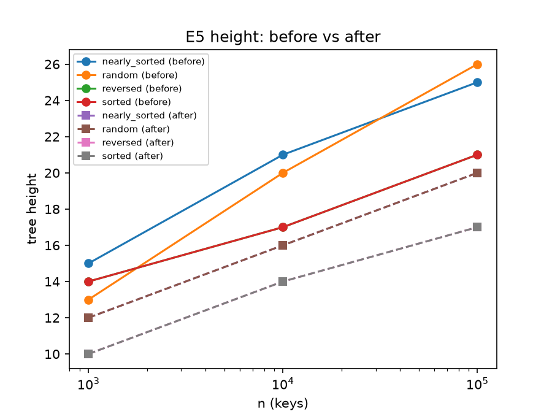
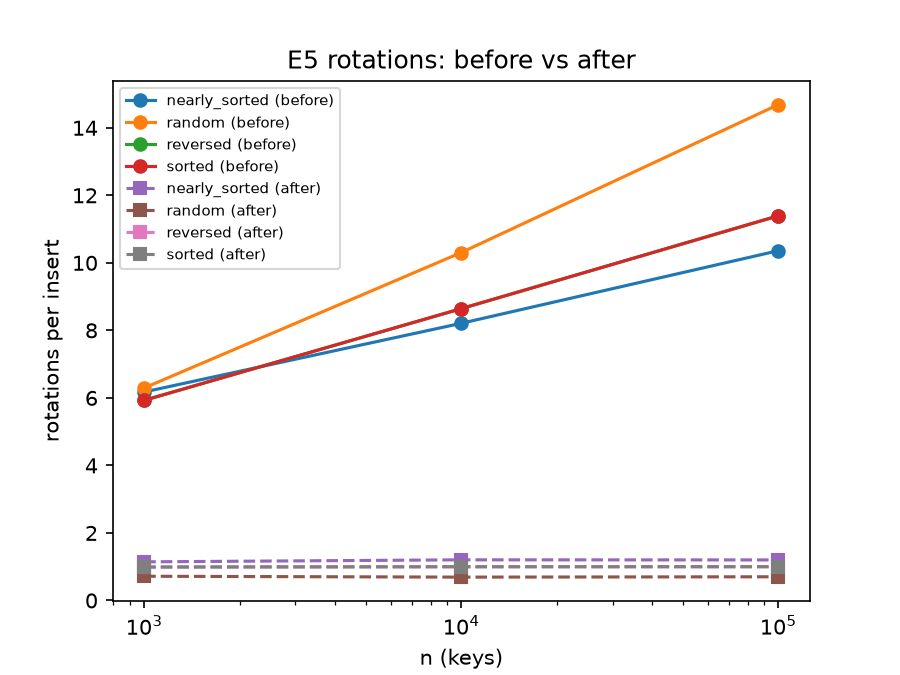

# INC-04: AVL tree does too many rotations due to height update in wrong order

## Summary

The AVL tree did too many rotations: about 13 per insert when building on all track IDs, when an AVL insert needs at most one rebalance (1 or 2 rotations) and less than one rotation on average. It also built taller trees than an AVL tree should have. This is because both the left and right rotations recalculated the parent's height before the child's height, even though the parent's height is calculated from the child's height. Swapping the two `_update_height` calls fixed it. In E1 on the same laptop (neil-mac), building all 114,000 track IDs went from 1,262 ms to 666 ms.

## Detection

We saw it in E5, the insert order experiment (the "E5 rotations per insert" graph). Rotations per insert grew with n when they should have stayed flat, and this happened in all four insert orders.

## Expected vs. observed

**Expected:** building should cost O(n log n), and rotations per insert should stay flat as n grows. The height should stay below 1.44·log₂(n), so for the n = 100,000 synthetic keys in E5 it should be at most 23.9.

**Observed:**

- 12.95 rotations per insert at n = 114,000 (Spotify data, E1).
- Rotations per insert went from 6.3 at n = 1,000 to 14.7 at n = 100,000 (E5, random order).
- At n = 100,000 the random-order height was 26 and the nearly-sorted height was 25, both above 23.9.

## Evidence



*E1 build time (left) and rotations per insert (right) vs. n. The after-fix line (orange) is lower for build time, and its rotations per insert stay flat.*



*E5 tree height vs. n for each insert order. After the fix the lines are lower, so the trees are no longer as tall.*



*E5 rotations per insert vs. n for each insert order. After the fix, rotations per insert don't grow as n grows. The tree heights come from `structure_info()`.*

Because the counters are deterministic, the extra rotations were not caused by noise or by anything about the laptop. The figures use code versions f6f773e (before) and 94403ce (after, our final commit), both run on neil-mac, so the build times are from the same laptop. The rotation and height counts are identical in the 549f076 run.

## Root cause

The bug is in `indexes/avl_tree.py`, in `_rotate_right` (lines 62–63) and `_rotate_left` (lines 80–81). A node's height is supposed to be 1 plus the largest height of its children, and after a rotation the old parent moves down and becomes a child. The code updated the new parent first, so it used the child's old height, which made the parent's height too large. Because of the wrong heights, the tree did rotations that were not needed, and the incorrect heights grew as n grew. The answers were still correct, because a rotation never breaks the key order, but the tree was doing extra work and ended up taller.

## Fix

In both rotation functions we swapped the order of the two `_update_height(x)` and `_update_height(y)` calls, so the node that moves down (the new child) is updated before the node that moves up (the new parent). Because the parent's height is calculated from its children's heights, the child has to be correct first.

Commits: `27e6aa4` (fixed `_rotate_left`), `549f076` (fixed `_rotate_right`), and `050f368` (finished the code comment). The after-fix experiments were run on `549f076`.

Diff (`git diff f6f773e..050f368 -- indexes/avl_tree.py`):

```diff
@@ -59,8 +59,8 @@ class AVLTreeIndex(Index):
         y.left = x.right
         x.right = y
         # x and y swapped places; refresh their stored heights.
+        _update_height(y) #y (child) must go first cuz parent h calc from childs height.
         _update_height(x)
-        _update_height(y)
         self.stats.rotations += 1
         return x

@@ -77,8 +77,8 @@ class AVLTreeIndex(Index):
         x.right = y.left
         y.left = x
         # x and y swapped places; refresh their stored heights.
+        _update_height(x) #x (child) must go first cuz parent h calc from childs height.
         _update_height(y)
-        _update_height(x)
         self.stats.rotations += 1
         return y
```

## Verification

- E1 rotations per insert: 12.95 → 0.55.
- E5 rotations per insert (n = 100,000): random 14.7 → 0.70, sorted and reversed 11.4 → 1.00, nearly sorted 10.4 → 1.20. Nearly sorted is above 1 because a double rotation counts as 2.
- E5 height (n = 100,000): random 26 → 20, sorted 21 → 17.
- E1 build on neil-mac: 1,262 ms (f6f773e) → 666 ms (94403ce).
- CORE build on chloe-mac: 859.9 ms (e9c1863) → 434.5 ms (9aba440).
- `make test` still passes.

## Impact on recommendations

For F4 the AVL tree builds better than it seemed before the fix, but it is still slower than the B+ tree, so we still recommend the B+ tree. Lookups also got a little cheaper: 16.8 → 15.7 comparisons per lookup.

## Why the tests didn't catch it

The tests only checked that the index returns the correct answers, not how much work it did to get them, and the buggy tree still returned correct answers. A test that would catch it would check that rotations per insert stay at or below about 1 on average (no more than 2 for any single insert), and that the `structure_info()` height is at most 1.44·log₂(n).
