# Practical 1 report: KNCV

## 1. Executive summary

We benchmarked five Python indexes and two C reference indexes on the 114,000-track Spotify catalog. We found four performance incidents in the interns' code, fixed all of them, and re-ran all seven experiments on the fixed code (commit 94403ce) on neil-mac. Our recommendations:

**F1, track page (point lookup by track_id): hash table.** It needed about 1.3 comparisons per lookup at every catalog size, so its work stays constant as the catalog grows, and it took 0.67 µs per hit at n = 114,000, the fastest of our five indexes (E2). Runner-up: AVL tree (1.38 µs).

**F2, search-as-you-type (prefix on track_name): B+ tree.** A five-character prefix took 5.9 µs vs. 9,400 µs for the hash table, which has to scan all buckets. It was the fastest of our five indexes at every prefix length, though only tied with the sorted list at lengths 1 and 5 (E4). Runner-up: sorted list.

**F3, workout mode (range on tempo): B+ tree.** The narrowest range took just 2.5 µs, against about 2,700 µs for the hash table's full scan, and the B+ tree was about twice as fast as the AVL tree at every range size (E3). The sorted list queries slightly faster but took over 4× longer to build (989 vs. 223 ms), so it is the runner-up, and the better choice only if the tempo index is rarely rebuilt.

**F4, catalog import (build): B+ tree.** It is the fastest ordered index to build: 223 ms at n = 114,000, against 666 ms for the AVL tree and 989 ms for the sorted list (E1). Insert order affected it much less than the sorted list (166–223 ms vs. 131–2,144 ms in E5). The hash table builds faster (76.8 ms) but it can't serve range or prefix queries, so it is the runner-up.

**Incidents found and fixed:**

- **INC-01, sorted list:** search scanned the list instead of using binary search. Comparisons per hit fell from 46,119 to 16.5.
- **INC-02, hash table:** the table grew by a fixed 1,024 buckets instead of doubling, which made building it O(n²). At n = 114,000, resizes fell from 117 to 14 and build time from 1,629 ms to 76.8 ms (both on neil-mac).
- **INC-03, B+ tree:** range and prefix queries visited the whole tree instead of following the leaf chain. A 1% range query fell from 45,653 comparisons to 474.
- **INC-04, AVL tree:** both rotations updated the new parent's height before the new child's, so stored heights were wrong and the tree did needless rotations and grew too tall. Rotations per insert at n = 114,000 fell from 12.95 to 0.55, and the E5 height of 26 (random order, n = 100,000; above the AVL limit of about 23.9) fell to 20.

The counters (comparisons, nodes visited, rotations, splits, resizes) were identical on all four laptops for the same code. The fastest laptop was a median of 3.2× faster than the slowest, and the order of the indexes from fastest to slowest stayed mostly the same (only indexes with close times swapped places), so none of our recommendations depends on the hardware. The C reference indexes were 1.2× to 5.5× faster than our Python versions, depending on how much of the work was already done in C, but their costs grew at similar rates as n increased, so the same choices would hold in a faster language.

## 2. How the indexes work (Part A)

Line numbers refer to the interns' original code (starter commit 6eed8a1; `indexes/` did not change until our fixes).

### Expected big-O per index

n is the number of keys stored and k is the number of results a range or prefix query returns. These are the costs each index should have in theory. Where the interns' code did not match, we say so below and in Section 5.

| Index | Build | Point lookup | Range | Prefix |
|---|---|---|---|---|
| Unsorted list | O(n) | O(n) | O(n) | O(n) |
| Sorted list | O(n²) (each insert shifts the list) | O(log n) | O(log n + k) | O(log n + k) |
| Hash table | O(n) average | O(1) average | O(n) | O(n) |
| AVL tree | O(n log n) | O(log n) | O(log n + k) | O(log n + k) |
| B+ tree | O(n log n) | O(log n) | O(log n + k) | O(log n + k) |
| dict reference | O(n) average | O(1) average | O(n) | O(n) |
| bisect reference | O(n²) (each insert shifts the list) | O(log n) | O(log n + k) | O(log n + k) |

Prefix search is the same as a range search for every index, because `base.py` turns a prefix into the range from the prefix to the prefix plus the largest Unicode character (`base.py` lines 100–102 and line 29).

### Q1: What work does search do as n grows?

#### Unsorted list (`indexes/unsorted_list.py`)

Search checks every stored (key, value) pair one by one and keeps the values whose key matches. It never stops early, even after finding a match, because the list isn't ordered and duplicate keys could be anywhere (the comment on line 27 says this). So a hit and a miss cost exactly the same: n comparisons. Expected cost: O(n).

Lines that do the work: line 28 is the list comprehension that loops over every entry and tests `k == key`, and line 29 adds the length of the list to the comparisons counter, one per entry examined.

#### Sorted list (`indexes/sorted_list.py`)

A sorted list should be able to find a key with binary search, which cuts the search space in half each step, so the expected cost is O(log n). The file already has a binary search, `_bisect_left` (lines 27–42), and `insert` (line 45) and `range_search` (line 71) both use it.

However, `search` itself (lines 53–65) does not use it. Instead it walks the list from the start (the `for` loop on line 57), checking each key until it finds a match (line 59) or passes where the key would be (line 62). Because the keys are sorted it can stop early, but a hit still looks at about half the list on average (and our misses looked at all of it: every real track ID starts with a digit and our miss keys were all letters, so every miss sorted after every real ID), so the interns' version costs O(n), not O(log n). This is the bug in INC-01. Lines 60 and 64 add the number of keys checked to the comparisons counter.

#### Hash table (`indexes/hash_table.py`)

Search does three things: it computes the hash of the key, takes it modulo the number of buckets to pick one bucket, and then looks through that one bucket, comparing each stored key with the target until it finds a match or reaches the end of the bucket (which means the key was never inserted).

The first two steps happen on line 40 (inside `_bucket_for`, called from line 69) and the bucket scan is lines 71–77. Hashing and picking a bucket are O(1) because they don't depend on n. The bucket scan depends on how long the bucket is, but lines 55–56 keep the average bucket short: whenever the number of keys goes above 0.75 per bucket on average, the table grows and spreads the keys out (`_grow`, lines 58–66). So the expected cost of a search is O(1). The worst case is O(n), if all keys ended up in the same bucket.

#### AVL tree (`indexes/avl_tree.py`)

Search starts at the root and at each node compares the target key with the node's key. It moves to the left child if the target is smaller, the right child if it's larger, or stops on a match. Each loop iteration goes down one level, so the number of nodes examined is at most the height of the tree. An AVL tree keeps its height at about log₂(n) (at most about 1.44 log₂(n)), so the expected cost is O(log n).

Lines that do the work: lines 123–130 are the `while` loop that walks down the tree one node per iteration, lines 125 and 127 are the comparisons that choose left or right, and lines 131–132 add the number of nodes visited to both `nodes_visited` and `comparisons`. It counts one comparison per node even though the code may test both `<` and `>`, which matches the definition in `base.py` lines 36–37.

#### B+ tree (`indexes/bplus_tree.py`)

Search first walks from the root down to the leaf where the key belongs (`_find_leaf`, lines 94–102). At each internal node it uses binary search over that node's keys to pick which child to follow (`_bisect_right`, lines 80–92, called on line 99). Once it reaches the leaf, `search` (lines 166–171) uses another binary search (`_bisect_left`, line 168) to find the key inside the leaf and returns its values if it's there.

The tree is balanced and every leaf is at the same depth, so the number of levels is about log base m of n, where m is the order (32 by default). At each level the binary search takes about log₂(m) comparisons. Multiplied together that is about log₂(n) comparisons, so the expected cost is O(log n), but with far fewer nodes visited than an AVL tree because each node holds many keys. Line 101 adds the number of levels visited to `nodes_visited`, and lines 77 and 91 add the binary search comparisons.

### Q2: Why can't the hash table answer a range query without looking at every key?

Because of the hash function (line 40), a hash table loses the order of the keys. Keys that are close in value, like tempos of 125 and 126, get scattered into unrelated buckets on purpose, and the bucket a key lands in says nothing about whether it is bigger or smaller than other keys. So there is no way to jump to where a range starts and walk forward. `range_search` (lines 79–88) has to loop over every bucket (line 82) and every key in each bucket (line 83) and check each one against the range (line 84), which costs O(n). The dict reference index has the same limitation for the same reason.

### Q3: Trace inserting 10, 20, 30 into an empty AVL tree

Insert 10: `insert` (line 102) calls `_insert` on an empty tree, which creates the node on line 107. The tree is just 10.

Insert 20: 20 > 10, so `_insert` goes right (line 113) and creates 20 as 10's right child. On the way back up, `_rebalance(10)` (line 117) finds a balance of 0 − 1 = −1, which is allowed, so there is no rotation (line 98).

Insert 30: it goes right of 10 and right of 20 (line 113 twice) and becomes 20's right child. On the way back up, `_rebalance(20)` finds a balance of −1, which is fine. Then `_rebalance(10)` computes 0 − 2 = −2 on line 87, so the right side is too tall (line 93). Line 95 checks 20's balance: it is −1, not greater than 0, so this is not the right-left case. It is the right-right case.

Line 97 calls `_rotate_left(10)`, which runs lines 75–83. Line 75 picks out 20 as `y`, 10 takes 20's empty left subtree as its right child (line 77), and 10 becomes 20's left child (line 78), which makes 20 the parent. Lines 80–81 then update the stored heights, and this is where INC-04 shows up: line 80 updates 20 first, while 10 still has its old height of 3, so 20's stored height becomes 4 instead of 2; line 81 then sets 10's height to 1. Line 82 adds 1 to the rotations counter. The new subtree root, 20, is returned up to line 102 and becomes the root of the tree.

Result: a single left rotation at 10. The tree is 20 at the root, with 10 as its left child and 30 as its right child. In the interns' code the stored height of 20 is 4 even though the real height is 2 (we checked this by running the original code); after our fix it is 2.

### Q4: In the B+ tree, what is `next` on a leaf for, and which methods use it?

`next` connects each leaf to the leaf immediately to its right. Since leaves hold their keys in sorted order, this makes a sorted linked list across the bottom of the tree, so you can move through keys in order from one leaf to the next without going back up to the root. That is what makes range and prefix queries efficient in a B+ tree: find the first leaf once, then walk sideways.

In the interns' code, `next` is defined in `_Leaf` (lines 28–34, set to `None` on line 34), kept up to date by `_split_leaf` when a leaf splits (lines 147–148, so the new right leaf is linked into the chain), and read by `structure_info` (lines 201–204) to walk the leaves and count them.

`range_search` does not use `next`. It calls `_collect_range` (lines 179–189), which recursively visits every child of every node (line 188) and checks every key in every leaf. So in the interns' version a range query looks at the whole tree, O(n), instead of finding the first leaf and following `next`, which would be O(log n + k).

### Q5: What does each counter in `Stats` count, for each index? Why are counters useful?

`Stats` has five counters (`base.py` lines 33–48): `comparisons`, `nodes_visited`, `rotations`, `splits`, and `resizes`. Each index only uses the ones that make sense for it; the rest stay at 0.

#### Unsorted list

`comparisons`: one per entry scanned. Every search and every range query adds the full length of the list (lines 29 and 34). `nodes_visited`, `rotations`, `splits`, and `resizes` are never incremented, because there are no nodes or buckets, just one list. `insert` (line 23) is a plain append and touches no counters.

#### Sorted list

`comparisons`: one per key checked. That is one per step of the binary search in `_bisect_left` (line 41), which `insert` and `range_search` use; one per key checked in `search`'s scan (lines 60 and 64); and one per key walked through in `range_search` (line 79). `nodes_visited`, `rotations`, `splits`, and `resizes` are never incremented.

#### Hash table

`comparisons`: one per stored key checked against the target inside a bucket, during `insert` (counted on line 46, added on line 53) and `search` (counted on line 72, added on lines 74 and 76). `range_search` adds the total number of keys in one step (line 86). `nodes_visited`: one per bucket touched, once per insert or search in `_bucket_for` (line 39), and the number of buckets for a range query (line 87). `resizes`: one each time the table grows (line 66). `rotations` and `splits` are never used. Moving keys during a resize is not counted as comparisons.

#### AVL tree

`comparisons` and `nodes_visited`: one per node examined, on every insert path (lines 108–109), search path (lines 131–132), and node visited by a range query (lines 145–146), so for this index the two counters are always equal. `rotations`: one per single rotation (lines 64 and 82); a double rotation (left-right or right-left) counts as 2. `splits` and `resizes` are never used.

#### B+ tree

`comparisons`: one per step of the binary search inside a node (lines 77 and 91), used on every insert and search, plus every key in every leaf a range query checks (line 186). `nodes_visited`: one per node on the path down for a search (line 101) or insert (line 117), and one per node a range query visits (line 181). `splits`: one per leaf split (line 149) and one per internal node split (line 161). `rotations` and `resizes` are never used.

#### Reference indexes (dict and bisect)

They do not count anything (they set `counts_operations = False` in `reference.py`, which `base.py` line 66 says means no counters), so all their counters stay at 0.

#### Why counters are useful when we already have timings

Counters are deterministic: the same keys and queries always produce the same counts on any machine, while timings change with the hardware, background load, and noise. That means counters measure the algorithm's actual work, so we can compare it directly with big-O theory and see exactly which kind of work (comparisons, nodes visited, rotations, splits, or resizes) is higher than it should be. That is how we found our incidents, and it is also why counters should be identical across our laptops for the same `code_version` (Part E).

## 3. Methods

### Setup

All measurements were run inside the provided Docker container (Python 3.13) using `make experiments` and `make core`, so everyone used the same Python version and packages. Every measurement was written to `results/timings.csv` through `ResultsWriter`, which also records the git commit (`code_version`), the member, and the machine. Unless stated otherwise, every configuration was run 5 times (5 replicates).

### Measurement rules

For every experiment, keys and queries were generated before the timer started, so we only timed the index itself. Build measurements (E1, E5, E6, E7) built a fresh index for each replicate using `time_build`. Query measurements called `reset_stats()` before each batch and timed the whole batch with `time_batch`, then we divided by the number of operations to get the cost per operation. In E2, E3, and E4 the index was built once (not timed) and then reused across replicates, because only the queries were being measured. Memory (`memory_bytes`) was measured once per configuration with `build_memory_bytes`, separately from timing, because tracing memory is slow. All query generation used the same seed (4300) so every index got the exact same queries.

### Experiments

E1, build cost vs. n: `track_id` keys in file order, at n = 1,000, 2,000, 5,000, 10,000, 30,000, 60,000, and all 114,000 tracks. Every index (the five main ones and the two references) was built and timed, and `memory_bytes` was recorded.

E2, point lookup cost vs. n: the same `track_id` sizes as E1. For each size we made 500 lookups that all hit (hit rate 1.0) and 500 that all miss (hit rate 0.0), and timed each batch. We also recorded tree height.

E3, range cost vs. selectivity: `tempo` keys for all tracks. For each selectivity (0.0001, 0.001, 0.01, 0.05, 0.1, and 0.25 of the distinct tempos) we made 200 range queries and timed each batch.

E4, prefix cost vs. prefix length: `track_name` keys for all tracks, with prefix lengths 1 through 5 and 200 prefix queries per length.

E5, insert order: synthetic keys from `random_keys` at n = 1,000, 10,000, and 100,000, inserted in each of the four orders (random, sorted, reversed, and nearly sorted, which is sorted followed by round(0.05 × n) swaps of two random positions). For each we timed the build with a fresh index, recorded the height and the rotation and split counters, and timed 500 lookups that all hit.

E6, B+ tree order: the B+ tree only, at orders 3, 4, 8, 16, 32, 64, 128, 256, and 512. For each order we timed building it on all track IDs (with memory), 500 hits and 500 misses, and 200 range queries at selectivity 0.01 on a separate B+ tree built on tempo.

E7, many rows sharing a key: `track_genre` and `popularity`, which have few distinct values, compared with `track_id`, which is mostly unique (89,741 distinct values in 114,000 rows). For each column we timed the build (with memory), 500 hits, and 500 misses. Popularity keys are integers from 0 to 100, so its misses were numbers outside that range. For popularity we also ran 200 range queries at selectivities 0.01, 0.05, 0.1, and 0.25.

### Synthetic data and queries (Part B)

We implemented the five functions in `datagen/synthetic.py`, and all randomness comes from `random.Random(seed)` so the same seed always gives the same output. `random_keys` makes n distinct random strings of a fixed length (8 lowercase letters by default). `arrange` puts keys in random, sorted, reversed, or nearly sorted order (sorted, then round(0.05 × n) random swaps). `point_queries` makes lookups where exactly round(n_queries × hit_rate) are hits and the rest are random strings guaranteed not to be keys. `range_queries` picks ranges that cover exactly w = max(1, round(selectivity × number of distinct keys)) distinct keys. `prefix_queries` takes the first few characters of randomly chosen keys that are long enough, so every prefix matches at least one key. `tests/test_synthetic.py` passes.

### How we summarized results

For each configuration we report the median of the 5 replicates, with the interquartile range (IQR) to show how much they varied, because the median is less affected by one slow run than the mean. To estimate how cost grows with n, we fit a straight line to log(cost) vs. log(n) and report the slope: about 0 means O(1), about 1 means O(n), and about 2 means O(n²). We used the counters and `structure_info()` alongside the timings because they don't depend on the machine.

### Machines

We used four laptops, one per team member. All four are Apple Silicon MacBooks running macOS.

| Machine | Member | Computer | CPU | Cores | RAM | macOS | Docker CPUs / memory | Power |
|---|---|---|---|---|---|---|---|---|
| kenza-mba | Kenza | MacBook Air 2022 | Apple M2 | 8 | 16 GB | 26.6.2 | 8 / 8 GB | plugged in |
| neil-mac | Neil | MacBook Neo | Apple A18 Pro | 6 | 8 GB | Tahoe 26.6.2 | 6 / 4 GB | battery |
| chloe-mac | Chloe | MacBook Air | Apple M5 | 10 | 24 GB | Tahoe 26.7 | 10 / 8 GB | battery |
| vicente-mba | Vicente | MacBook Air 2020 | Apple M1 | 8 | 8 GB | 26.4 | 8 / 4 GB | battery |

Three of the four laptops ran on battery, which can make timings slower and noisier than when plugged in. neil-mac, which produced every number in Section 4, was one of them, and we did not record this in the `notes` column of `results/timings.csv`. We keep this in mind when comparing timings across machines in Section 6, and we rely on the counters, which don't depend on the machine, wherever possible.

## 4. Results

All results in this section come from neil-mac on the final commit 94403ce, which includes all four fixes. Each number is the median of 5 replicates, the error bars in the figures show the IQR, and slopes are least-squares fits on log-log axes. Figures are made in `analysis/results.ipynb` and saved in `analysis/figures/`.

### E1: Build cost vs. n

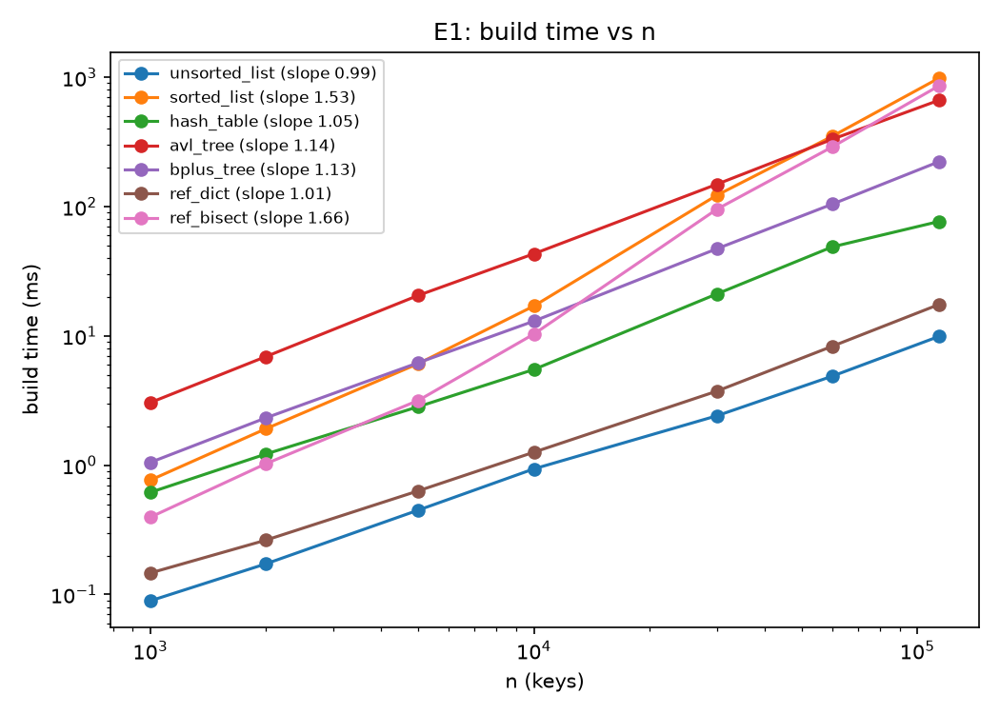

*Figure 1: build time (ms) vs. n (keys) on log-log axes for every index, with the fitted slope in the legend. Lines with slope near 1 are O(n); the sorted list and ref_bisect are steeper and cross above the AVL tree at large n. Error bars show the IQR of the 5 reps. Made in analysis/results.ipynb, E1 cell.*

At n = 114,000 the unsorted list built fastest (9.9 ms), followed by ref_dict (17.5 ms), the hash table (76.8 ms), the B+ tree (223 ms), the AVL tree (666 ms), ref_bisect (862 ms) and the sorted list (989 ms). The unsorted list (slope 0.99), hash table (1.05) and ref_dict (1.01) match the expected O(n). The AVL tree (1.14) and B+ tree (1.13) match O(n log n), since the log factor adds only about 0.1 to the slope over this range. The sorted list (1.53) and ref_bisect (1.66) grow faster than the others, as expected from shifting the list on every insert. They fall short of a slope of 2 because the shifting is done by fast C code, so it only starts to dominate at large n.

This produces a crossover. The AVL tree is the slowest index to build up to n = 30,000, but the sorted list passes it between 30,000 and 60,000 (350 vs. 332 ms at 60,000), and ref_bisect passes it between 60,000 and 114,000. By n = 114,000 the AVL tree ranks 5th of 7, ahead of ref_bisect and the sorted list. Memory per row ranged from 65 bytes (unsorted list) to 195 bytes (hash table, whose empty buckets cost space); the B+ tree used 80 and the AVL tree 115.

### E2: Point lookup cost vs. n

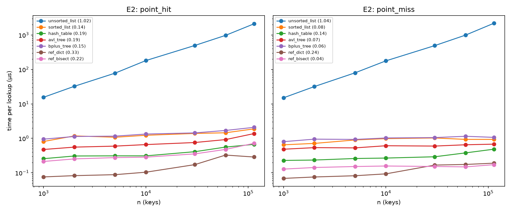

*Figure 2: time per point hit (left) and miss (right) in µs vs. n on log-log axes, with fitted slopes. Only the unsorted list grows linearly; every other index stays nearly flat. Error bars show the IQR of the 5 reps. Made in analysis/results.ipynb, E2 cell.*

The unsorted list is the only index whose lookups grow with n (slope 1.02 for hits, 1.04 for misses), reaching about 2,100 µs per lookup at full size, with exactly n = 114,000 comparisons for both hits and misses. That is the expected O(n) full scan: search must collect every duplicate, so it cannot stop early.

Every other index stayed between 0.07 and 2.1 µs. At n = 114,000, ref_dict was fastest for hits (0.29 µs), then the hash table (0.67), ref_bisect (0.72), the AVL tree (1.38), the sorted list (1.88) and the B+ tree (2.09). The counters back this up. The hash table needed about 1.3 comparisons per hit at every size, which is O(1). The sorted list, AVL tree and B+ tree each needed 15–17 comparisons, close to log₂(89,741) ≈ 16.5 (the trees hold 89,741 distinct track IDs), which is O(log n). The fixed sorted list now matches this (16.5 comparisons per hit, compared with 46,119 before INC-01).

The hash table and ref_dict timings still rose slightly with n (slopes 0.19 and 0.33) even though their comparison counts stayed constant. The likely cause is the CPU cache: a larger table no longer fits in fast cache memory, so each lookup waits longer for memory without doing more work. Rankings barely changed across sizes. For hits, the hash table moved just ahead of ref_bisect at full size (0.67 vs. 0.72 µs), and the sorted list and B+ tree swapped places once, at n = 2,000. For misses, ref_bisect was faster than ref_dict from n = 30,000 on.

### E3: Range cost vs. selectivity

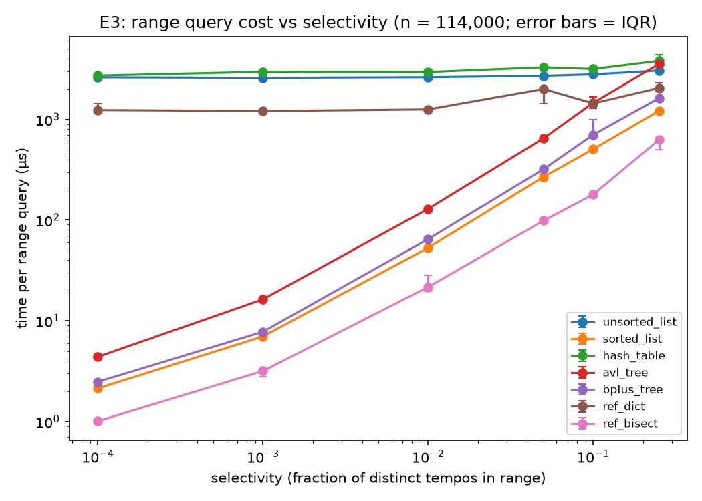

*Figure 3: time per range query (µs) vs. selectivity on log-log axes, n = 114,000 tempo keys. Ordered indexes grow with the size of the range; the hash table, ref_dict and unsorted list stay near the cost of a full scan and rise only slightly. Error bars show the IQR of the 5 reps. Made in analysis/results.ipynb, E3 cell.*

The ordered indexes match the expected O(log n + k). At the smallest selectivity (0.0001), ref_bisect took 1.0 µs, the sorted list 2.1 µs, the B+ tree 2.5 µs and the AVL tree 4.4 µs, using only 19–22 comparisons, roughly log n plus a few matches. Their cost then grew in proportion to the range: at selectivity 0.25 the sorted list took 1,215 µs and 11,430 comparisons. The B+ tree consistently took about half the time of the AVL tree (1,625 vs. 3,536 µs at 0.25), because it walks the leaf chain instead of visiting tree nodes one at a time. The INC-03 fix shows up here too: B+ tree range comparisons were 474 at selectivity 0.01, compared with 45,653 before.

The unordered indexes stayed near the cost of a full scan: the unsorted list at 2,580–3,050 µs, the hash table at 2,720–3,810 µs, and ref_dict at 1,210–2,050 µs. They still rose 17–65% from the narrowest to the widest range, probably because building a longer result list takes longer. ref_bisect was the fastest index at every selectivity, about 2–3× faster than the sorted list with the same growth. The gap between ordered and unordered indexes narrows as ranges get larger, and wide ranges produce a crossover: at selectivity 0.25 the AVL tree (3,536 µs) was slower than the unsorted list's full scan (3,051 µs) and ref_dict (2,050 µs), and only a little faster than the hash table (3,809 µs). So for very wide ranges the AVL tree loses its advantage completely, while the B+ tree and sorted list were still faster than every full scan (the B+ tree by 1.3× over ref_dict and 1.9× over the unsorted list).

### E4: Prefix cost vs. prefix length

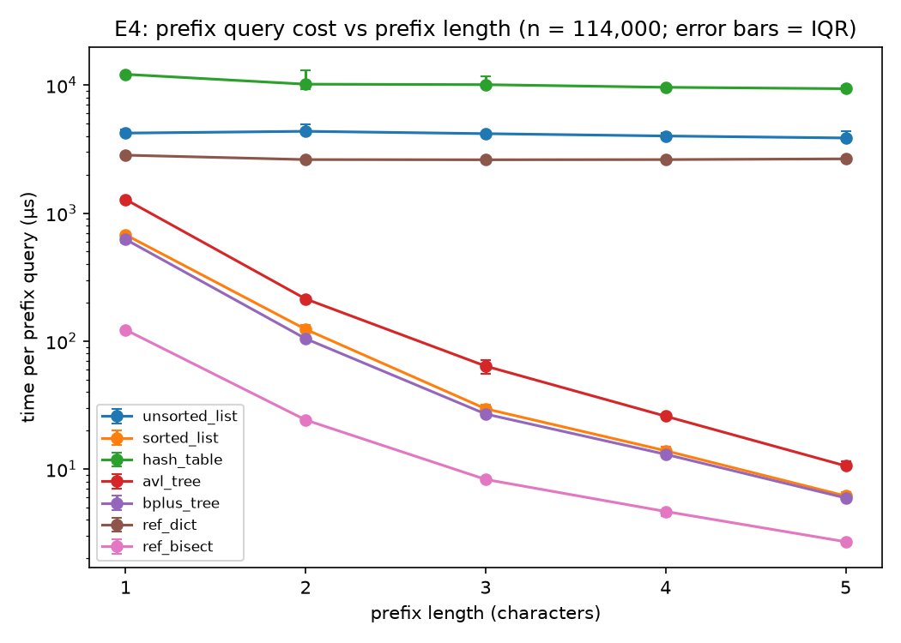

*Figure 4: time per prefix query (µs, log scale) vs. prefix length on track_name, n = 114,000. Ordered indexes get about 100× faster as the prefix lengthens and fewer titles match; unordered indexes stay flat. Error bars show the IQR of the 5 reps. Made in analysis/results.ipynb, E4 cell.*

Prefix queries behave like range queries, because `base.py` turns each prefix into a range. For the ordered indexes, cost depends on how many titles match. A 1-character prefix matches thousands of titles: ref_bisect took 122 µs, the B+ tree 623 µs, the sorted list 677 µs and the AVL tree 1,278 µs. A 5-character prefix matches only about 20 titles on average, and the same indexes took 2.7, 5.9, 6.2 and 10.6 µs. The unordered indexes cannot narrow the search and stayed flat: ref_dict at about 2,600–2,850 µs, the unsorted list at 3,860–4,360 µs, and the hash table at 9,400–12,100 µs, the slowest of all because it scans every bucket. Even for 1-character prefixes, every ordered index beat every unordered one.

### E5: Insert order

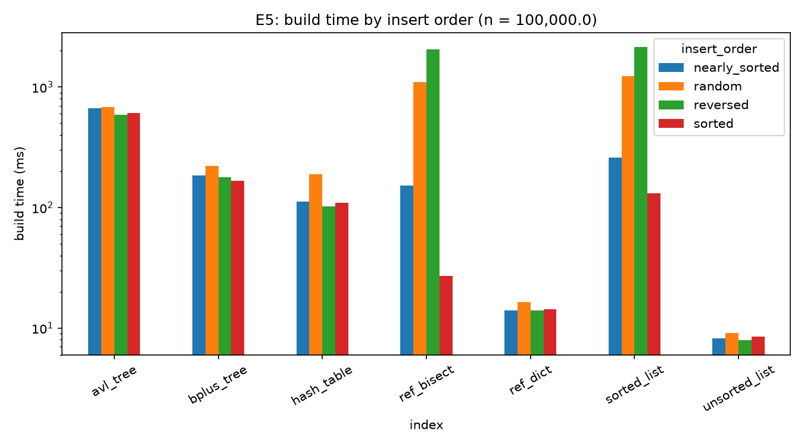

*Figure 5: build time (ms, log scale) for each index and insert order at n = 100,000 synthetic keys. The list-based ordered indexes are by far the most sensitive to order, and reversed order is slowest for them because every insert shifts the whole list; the hash table and B+ tree are somewhat slower in random order. Error bars show the IQR of the 5 reps. Made in analysis/results.ipynb, E5 cell.*

Insert order mattered most for the two list-based ordered indexes. The sorted list took 131 ms in sorted order, 258 ms nearly sorted, 1,236 ms random and 2,144 ms reversed, a 16× spread; ref_bisect ranged from 27 to 2,055 ms. In sorted order every new key goes at the end, so nothing shifts. In reversed order every key goes at the front and shifts the whole list, which is the O(n²) worst case.

The trees were much less sensitive to order. AVL build times stayed within 590–679 ms and B+ tree times within 166–223 ms. The B+ tree's 1.34× spread was not zero, though: random order was slowest even though it needed the fewest splits (4,829, vs. 6,635 in sorted order), so the counters don't explain the extra time. The hash table was also 1.7–1.9× slower in random order (190 vs. 102–112 ms; 1.1–1.2× on chloe-mac). The AVL tree did the most rotations on nearly sorted input (120,055) and the fewest on random input (70,144), but its height stayed between 17 and 20 in every case, close to log₂(100,000) ≈ 17. The B+ tree had a height of 4 for every order and split 4,829–6,661 nodes. The unsorted list (8–9 ms) and ref_dict (14–17 ms) did not care about order at all. Point lookups after building changed by up to about 1.5× between orders, but the sorted list, whose final structure is identical for every order, varied by the same amount (1.50–2.21 µs), so we treat these differences as noise.

### E6: B+ tree order

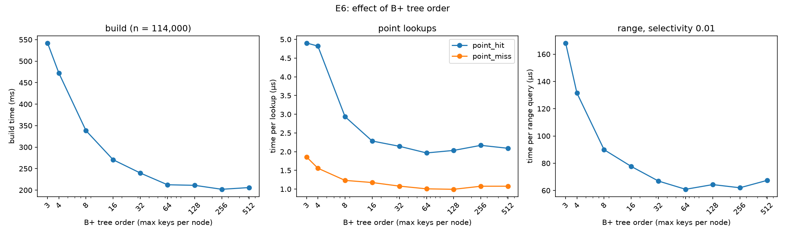

*Figure 6: B+ tree build time (ms), point lookup time (µs) and range query time (µs) vs. tree order (max keys per node, log scale). All three improve steeply up to order 32–64 and then level off. Error bars show the IQR of the 5 reps. Made in analysis/results.ipynb, E6 cell.*

Increasing the order (keys per node) made the tree shorter: height fell from 14 at order 3 to 4 at order 32 and 2 at order 512. Every cost improved with it up to about order 64 and then leveled off. Build time fell from 542 ms to about 200–210 ms, memory from 28.9 MB to about 8.3–8.7 MB, point hits from 4.9 µs to 2.0 µs, and range queries at selectivity 0.01 from 168 µs to 61 µs. Order 64 had the fastest hits (1.97 µs) and ranges (60.9 µs), and orders 256–512 the fastest builds (202–206 ms), but above order 64 the differences are small and the IQRs of neighbouring orders often overlap, so anything from 64 to 256 is a reasonable choice.

This flattening is what we expected. The tree has about log_m(n) levels, and each level does a binary search over m keys, so the total comparisons stay around log₂(n) whatever the order. A higher order only saves time by visiting fewer nodes, and once the tree is 3 levels deep there are few hops left to save. The default order of 32 was within about 10% of the best for lookups and ranges, but its build was 19% slower than order 256 (240 vs. 202 ms).

### E7: Many rows sharing a key

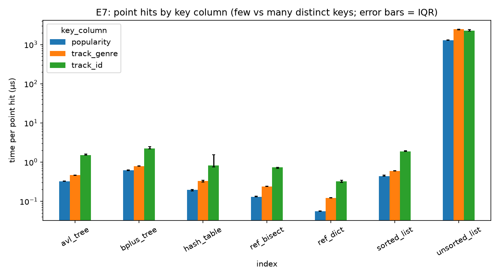

*Figure 7: time per point hit (µs, log scale) for each index on track_genre and popularity (few distinct values) and track_id (79% unique). Every index except the unsorted list is faster on the columns with many duplicates, because it stores far fewer distinct keys. Error bars show the IQR of the 5 reps. Made in analysis/results.ipynb, E7 cell.*

Keys with many duplicates made every index except the unsorted list faster, because each duplicate is appended to an existing key's list of values. The structure only stores about 101 distinct popularity values or 114 genres, instead of 89,741 distinct track IDs. The biggest gains were in build time for the list-based ordered indexes: the sorted list took 58 ms on genre or popularity against 1,046 ms on track_id (18×), and ref_bisect 17–22 ms against 932 ms. The AVL tree (211–236 vs. 788 ms) and B+ tree (83–87 vs. 272 ms) gained about 3–4×. The unsorted list stays at one entry per row, so its build time (9–12 ms) did not change.

Point hits were also faster on duplicate-heavy keys, for example 0.33 µs on popularity (0.47 µs on genre) against 1.51 µs on track_id for the AVL tree. Returning a long list of row ids costs nothing extra, because search returns the stored list without copying it. The unsorted list still scanned all 114,000 rows on every lookup (1,300–2,500 µs).

Range queries on popularity show that a full scan only costs O(number of distinct keys) for indexes that group duplicates. At selectivity 0.01, the hash table (10.8 µs) and ref_dict (5.4 µs) were nearly as fast as the ordered indexes (2.8–4.8 µs), because there were only about 101 keys to check. The unsorted list, which scans every row, took 1,820 µs. With so few distinct keys, the choice of index matters much less than whether it groups duplicates.

## 5. Performance incidents (Part D)

### INC-01: Sorted list point lookups grow with n instead of log n

Point lookups on the sorted list got slower as n grew, because `search` (`sorted_list.py` lines 57–63) walked the key list from the start instead of using the class's own binary search, `_bisect_left`, which `insert` and `range_search` already used. That made each lookup O(n) instead of O(log n). In E2 at n = 114,000, a hit took 46,119 comparisons and about 3,058 µs, against about 17 comparisons expected, and the fitted log-log slope of comparisons vs. n was 0.96. The counters were identical on all four machines in the original CORE runs, so the extra work came from the code itself. We replaced the loop with `_bisect_left` plus an equality check (commit 09fddb5). After the fix, a hit took 16.5 comparisons and 1.94 µs (about 1,600× faster), the slope dropped to 0.11 (what log₂ n looks like on log-log axes over this range), and `make test` still passes. The remaining ~2.7× gap to ref_bisect (0.73 µs in the same run) is the constant-factor cost of running binary search in Python rather than C.

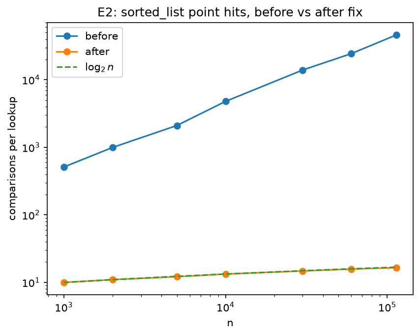

*Figure 8: comparisons per point hit for `sorted_list` in E2, before (f6f773e) and after (09fddb5) the fix, on log-log axes, against the log₂ n theory line. After the fix the points sit on the theory line. Made in analysis/sorted_analysis.ipynb, E2 before/after cell.*

### INC-02: Hash table build cost grows with n² instead of n

Building the hash table got much slower as n grew, because `_grow` (`hash_table.py` line 60) added a fixed 1,024 buckets every time the table filled up instead of growing in proportion to its size. That made it resize about every 768 inserts, and every resize moves every key, so building the table cost O(n²) instead of O(n). In E1 with all 114,000 track IDs, the table resized 117 times and the fitted log-log slope of build time vs. n was 1.72. We changed line 60 to double the number of buckets (commit 305b687). After the fix, the same E1 build needed only 14 resizes, the slope dropped to 1.05 (matching O(n)), and the build took 76.8 ms instead of 1,629 ms on the same laptop (neil-mac). `make test` still passes.

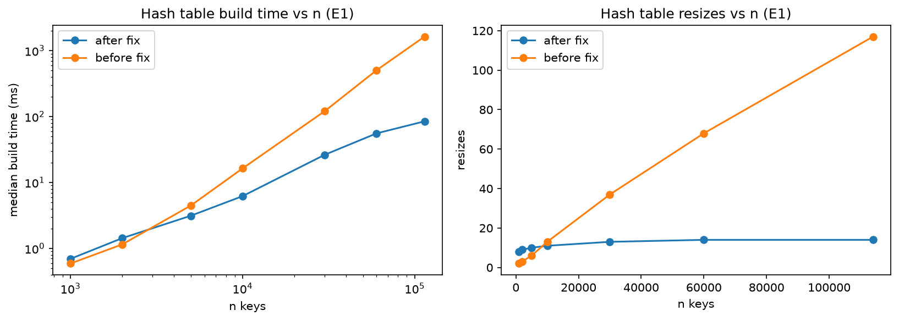

*Figure 9: hash table build time (ms, log-log, left) and number of resizes (right) vs. n (keys) in E1, before (f6f773e) and after (94403ce) the fix, both on neil-mac. Before the fix the resizes grow in a straight line with n and the build time curve is steeper (slope 1.72 vs. 1.05). Made in analysis/hash_analysis.ipynb.*

### INC-03: B+ tree range and prefix queries scan the whole tree

The B+ tree's `_collect_range` recursed into every child of every node without first checking whether that child could overlap the query range, so every range and prefix query scanned the whole tree: 45,653 comparisons for a 1% range query instead of about 474. The results were still correct, so the correctness-only tests missed it. The CORE suite showed it first, and E3 confirmed it, because the B+ tree's comparison count stayed flat at every selectivity (Figure 10). Our fix (commit c8ec36c) descends once to the leaf where `lo` belongs and then walks the `next` pointers until it passes `hi`. That restores O(log n + k) and, in vicente-mba's CORE runs, cut range queries from 4.90 ms to 0.19 ms (26×) and 3-letter prefix queries from 10.4 ms to 0.07 ms (157×). After the fix the B+ tree does the same work as the sorted list and becomes a candidate for F2 and F3.

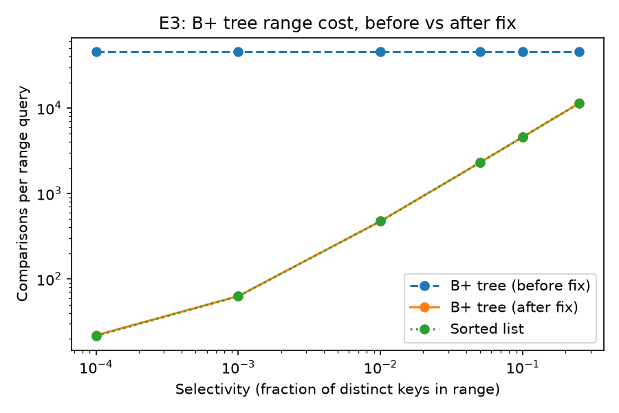

*Figure 10: comparisons per range query vs. selectivity (log-log) in E3, for the B+ tree before (f6f773e) and after (c8ec36c) the fix and for the sorted list. Before the fix the B+ tree line is flat at 45,653 comparisons; after it, it lies on top of the sorted list. Made in analysis/bplus_analysis.ipynb.*

### INC-04: AVL tree does too many rotations due to height update in wrong order

The AVL tree did too many rotations while building. Both `_rotate_right` (lines 62–63) and `_rotate_left` (lines 80–81) recalculated the new parent's height before the new child's. A node's height is 1 plus the larger of its children's heights, so the parent was computed from the child's old height. The wrong heights triggered unnecessary rotations, and the error grew with n. In E1 the tree did 12.95 rotations per insert on all 114,000 track IDs, when an AVL insert needs at most one rebalance (a single or double rotation, so 1–2 rotations) and usually fewer than one rotation on average. In E5 (random order, n = 100,000) the height reached 26, above the AVL limit of about 23.9 (1.44·log₂ n). Search answers were still correct, so the tests could not catch it; the tree was just doing extra work. We swapped the two height updates so the child is updated first (commit 549f076), and `make test` still passes. Rotations per insert dropped to 0.55 and stayed flat as n grew, and the build got faster: 1,262 ms to 666 ms in E1 on neil-mac.

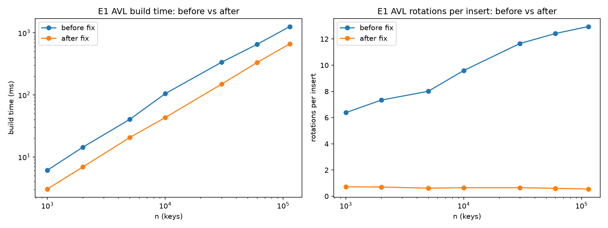

*Figure 11: AVL tree build time (ms, log-log, left) and rotations per insert (right) vs. n (keys) in E1, before (f6f773e) and after (94403ce) the fix, both on neil-mac. After the fix (orange) the build is about 1.9× faster at full size, and rotations per insert stay flat between 0.55 and 0.72 instead of climbing to 12.95. Made in analysis/AVL_tree.ipynb, E1 build cell.*

## 6. Hardware comparison (Part E)

We compared the CORE runs from all four machines before and after fixes. The before-fix runs used commits 2c52c55, e9c1863 and e9db2d1 while after-fix runs used 9aba440, 65bfead and 65c95ad. Analysis for this section is in `analysis/Hardware_comparisons.ipynb`.

### Q1: Are the counters identical across machines for the same code_version?

Yes. Every machine and every rep produced exactly the same comparisons, nodes visited, rotations, splits and resizes. The only counters that changed were due to fixes: sorted list point lookup dropped from 45,614 to 16.5 comparisons per hit, B+ tree range queries from 45,653 to 474, and the AVL tree and hash table builds and lookups also dropped. Counters depend only on the code which makes it a reliable way to compare algorithms as opposed to run time between machines.

### Q2: How much faster is the fastest machine than the slowest, and is the ratio the same across indexes and operations?

chloe-mac (M5) was fastest and vicente-mba (M1) slowest in all 42 configurations, with a median ratio of 3.2×. The gap was smaller for the C reference indexes (median 2.5×) than for the Python indexes (median 3.3×). The largest ratios (AVL point hits 19.7×, B+ tree build 8.4×) come from Vicente's noisy after-fix run (Q4); among the other three machines, ratios ranged from 1.2× to 2.2× (median 1.46×). Because the benchmarks are single-threaded, per-core speed matters more than core count: neil-mac's 6-core A18 Pro beat kenza-mba's 8-core M2 on most point-hit bars (Figure 12).

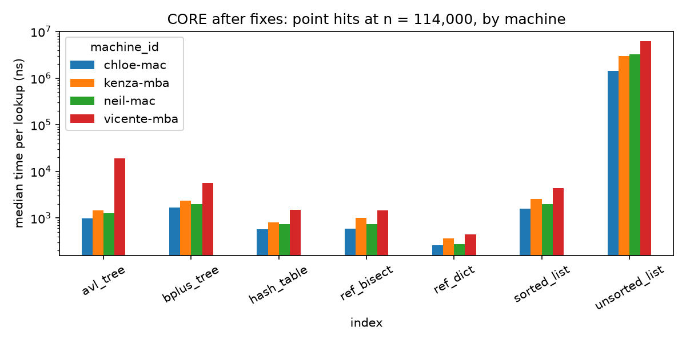

*Figure 12: median time per point hit (ns, log scale) at n = 114,000, by index and machine, CORE after fixes. For each index the machines differ mainly by a constant factor, with chloe-mac lowest and vicente-mba highest; the tall vicente-mba AVL bar is a noise spike. Made in analysis/Hardware_comparisons.ipynb, figure cell.*

### Q3: Does the ranking of the indexes change from machine to machine?

Mostly no. Each index kept the same rank on all four machines in 29 of 42 index–operation pairs, but the full ranking matched for only 1 of 6 operations (the 10,000-key build, Q3). The fastest index never changed: ref_dict for point lookups, ref_bisect for range and prefix, unsorted_list for builds. The slowest was also stable, except on range queries (hash table on three machines, unsorted list on neil-mac). The 13 disagreements are swaps between neighbouring indexes with similar times (e.g. hash_table vs. ref_bisect on point hits) plus Vicente's noisy AVL rows. The closest call that matters, B+ tree vs. sorted list on prefix queries, is also close in E4 (tied at lengths 1 and 5), and we chose the B+ tree for its cheaper build anyway, so no swap changes a recommendation.

### Q4: How variable are repeated runs on each machine, and is any machine noisier?

We measured noise as the coefficient of variation (SD / mean) across 5 reps (Q4). After the fixes, kenza-mba (plugged in) was steadiest (median CV 0.023), then chloe-mac (0.033) and neil-mac (0.059). vicente-mba was by far the noisiest (0.147), though his before-fix run was steady (0.035), suggesting background load or battery throttling rather than hardware.

### Q5: How much RAM does each index need, and could RAM differences between machines matter?

CORE doesn't record memory, so we used E1's `memory_bytes` from neil-mac (Q5). At n = 114,000, the indexes need 7.4 MB (unsorted list) to 22.3 MB (hash table). Including the loaded dataset, a full run needs about 2,000 bytes per row, so even the smallest Docker limit on the team (4 GB) would last until about 2 million rows, roughly 18× our catalog. RAM differences between machines therefore don't matter, and since memory depends on code and Python version rather than hardware, one machine's measurement is representative.

## 7. Recommendations

| Feature | Recommended | Runner-up | Strongest evidence |
|---|---|---|---|
| F1 Track page | Hash table | AVL tree | 0.67 µs per hit vs 1.38 µs for the AVL tree (E2) |
| F2 Search-as-you-type | B+ tree | Sorted list | Fastest or tied at every prefix length (E4) |
| F3 Workout mode | B+ tree | Sorted list | 64.8 µs per 1% range vs 2,950 µs for the hash table (E3) |
| F4 Catalog import | B+ tree | Hash table | Fastest ordered build: 223 ms at n = 114,000 (E1) |

### F1: Track page

The hash table computes a track ID's bucket and jumps straight to it, so its cost stayed nearly flat as n grew: 0.67 µs per hit, 0.49 µs per miss. The trade-offs are memory (22.3 MB, against 13.1 MB for the AVL tree and 9.2 MB for the B+ tree) and no range queries. If the catalog moved to disk, we would choose a B+ tree instead.

### F2: Search-as-you-type

A prefix query is a range query, so ordered indexes jump to the first match. The B+ tree narrowly beat the sorted list (623 vs 677 µs for 1 character, 5.9 vs 6.2 µs for 5; the IQRs overlap at both) and builds 4× faster (223 vs 989 ms). It needs a reasonable order: orders 3–8 were slower on every operation (E6). For a title index that never changes, the sorted list works equally well.

### F3: Workout mode

At selectivity 0.01 the sorted list took 53.2 µs, the B+ tree 64.8 µs and the AVL tree 129.3 µs, against about 2,600–2,950 µs for the full scans. The sorted list queries slightly faster but builds 4× slower and is costly to update, so it wins only if the tempo index is built once.

### F4: Catalog import

The hash table builds fastest (76.8 ms) but serves only exact lookups, so the B+ tree (223 ms) is the fastest index that keeps keys ordered, and insert order barely affected it (E5). The sorted list beats it only when new keys always arrive sorted and after every existing key (131 vs 166 ms in E5). Nightly track IDs are random, so in practice it would keep shifting.

### What the reference indexes reveal

The C versions show how much cost comes from Python itself. dict was 2.3× faster than our hash table on hits and 4.4× faster to build; ref_bisect was 2.6× faster than our sorted list on hits but barely faster to build (862 vs 989 ms), because list shifting already runs in C in both. C speeds every index up by a constant factor without changing its growth rate, so our recommendations hold in any language.

## 8. Limitations

Our experiments only go up to n = 114,000, so we would like to measure a much larger n to see whether the growth rates hold. Other apps running on our laptops, and running on battery instead of plugged in, add noise to the timings, and next time we would keep these conditions more consistent. Finally, everything was measured in memory, so the usual claim that a B+ tree wins on disk is not something we tested.

## Appendix

### Team contributions

**Part A:** Kenza answered the questions for the unsorted list, sorted list, and AVL tree, Neil for the hash table, and Chloe for the B+ tree.

**Part B:** Kenza wrote `random_keys` and `arrange`. Neil wrote `point_queries`, `range_queries`, and `prefix_queries`.

**Part C:** Chloe wrote E1–E4 and Vicente wrote E5–E7. Neil ran the final E1–E7 measurements on neil-mac.

**Part D:** Neil investigated the sorted and unsorted lists (INC-01; the unsorted list matched theory, so it has no incident), Kenza the hash table (INC-02), Vicente the B+ tree (INC-03), and Chloe the AVL tree (INC-04). Each person wrote the incident report and report summary for their index.

**Part E:** Every member ran the CORE suite on the original code and again after all fixes. Neil wrote the hardware comparison.

**Report:** Each member wrote the sections for their respective work. We all drafted and edited the final report, with Kenza and Neil doing the final checks before submission and fixing last-minute bugs.

### AI assistance

- **Chloe:** used Claude to help get the code diff for the Fix section of INC-04, to help format the results page, and to explain anything that was unclear before labeling all the figures for E1–E7.
- **Vicente:** used Claude to help with grammar, wording and formatting in the executive summary, to explain E6 specifically and give guidance on how to fully complete it, and for some help with the structure needed to graph the B+ tree diagram. Also used Claude to "condense" section 7
- **Kenza:** used Claude Code to check the report's numbers against `results/timings.csv`, fix the analysis notebooks so they reproduce every figure (including adding IQR error bars), and fix typos, formatting and number errors across the report and incident reports. Kenza reviewed the changes before committing them.
- **Neil:** [Neil: add what you used AI for here.]
- **All members:** used Claude to check for typos and to flag any places where the report didn't match their code or what other members had written.
